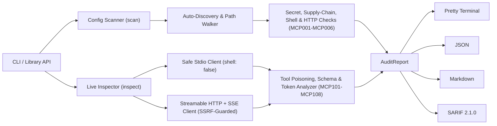

# @pie527645-cloud/mcp-doctor

Security, prompt-injection, tool-poisoning, configuration, and context-token-tax auditor for **Model Context Protocol (MCP)** servers.

`@pie527645-cloud/mcp-doctor` provides both a zero-runtime-dependency Node.js CLI (`mcp-doctor`) and a typed programmatic library to audit local/IDE MCP configurations and live MCP servers (`stdio` and Streamable HTTP / SSE) before they reach developer workstations or production agents.

---

## Features

- **Static Configuration Security (`mcp-doctor scan`)**
  - Auto-discovers standard MCP configs across Claude Desktop, Claude Code, Cursor, VS Code (`.vscode/mcp.json`), Antigravity, Windsurf, and project `.mcp.json` files—or audits explicit file/directory paths.
  - Detects exposed plaintext credentials (AWS, OpenAI, Anthropic, GitHub, Apify, Stripe, Slack, Bearer tokens, PEM keys, credentialed connection URIs, and high-entropy secrets) with automatic evidence redaction while ignoring dynamic `${ENV_VAR}` placeholders.
  - Flags unpinned supply-chain execution (`npx -y`, `@latest`, `bunx`, `uvx`), shell command-injection metacharacters (`&&`, `||`, `|`, `;`, `$(...)`, backticks), shell wrappers (`sh -c`, `cmd /c`), cleartext remote `http://` / `ws://` endpoints, and malformed JSON.
- **Live Protocol & Tool-Poisoning Inspection (`mcp-doctor inspect`)**
  - Connects via real MCP JSON-RPC 2.0 (`initialize` -> `notifications/initialized` -> `tools/list`, plus graceful best-effort `resources/list` and `prompts/list`).
  - Uses a safe quote-aware argv tokenizer with `spawn(cmd, args, { shell: false })` (never `shell: true`) and clean cross-platform child process termination on exit or timeout.
  - Supports Streamable HTTP JSON-RPC (`Accept: application/json, text/event-stream`), SSE response parsing, `Mcp-Session-Id` propagation, and manual redirect SSRF/metadata protection.
  - Detects invisible zero-width and BiDi Unicode (`U+200B..U+200F`, `U+202A..U+202E`, `U+2060..U+206F`, `U+FEFF`, `U+E0000..U+E007F`), hidden HTML/XML comments (`<!-- ... -->`), prompt-injection overrides (`ignore previous`, `system prompt`, `disregard`, `you must`, `<IMPORTANT>`, `<instructions>`), credential/file exfiltration (`~/.ssh`, `~/.aws`, `.env`, `/etc/passwd`, `id_rsa`, API key harvesting), and cross-tool shadowing directives.
  - Validates tool definitions and JSON Schema `inputSchema` objects, and calculates handshake latency plus per-tool and server-wide **Context Token Tax**.
- **CI-Ready Output Formats & Exit Codes**
  - Emits `pretty`, `json`, `markdown`, and **SARIF 2.1.0** compatible with GitHub Code Scanning.

---

## Architecture



---

## Requirements & Installation

Requires **Node.js >= 20** (tested on Node 20 and Node 22 across Linux and Windows).

```bash
git clone https://github.com/pie527645-cloud/mcp-doctor.git
cd mcp-doctor
npm install
npm run build

# Run directly from build output
node ./dist/cli.js --help

# Optional: link the local binary into your global PATH as `mcp-doctor`
npm link
mcp-doctor --help
```

> **Note on Windows PowerShell:** If PowerShell ExecutionPolicy blocks `.ps1` shims, run `npm.cmd install`, `npm.cmd run build`, and `node ./dist/cli.js ...`.

---

## CLI Usage

### 1. Scan MCP Configuration Files

```bash
# Auto-discover standard IDE and project MCP config files
node ./dist/cli.js scan

# Scan specific files or directories and fail on medium+ severity
node ./dist/cli.js scan ./.mcp.json ./.vscode/mcp.json --fail-on medium

# Emit Markdown summary (useful for $GITHUB_STEP_SUMMARY)
node ./dist/cli.js scan ./configs --format markdown
```

### 2. Inspect a Live MCP Server

```bash
# Inspect a local stdio MCP server safely (quote-aware argv, shell: false)
node ./dist/cli.js inspect --stdio "node ./path/to/mcp-server.js" --timeout 10000 --fail-on high

# Inspect a Streamable HTTP / SSE MCP endpoint and output JSON
node ./dist/cli.js inspect --url "http://127.0.0.1:3000/mcp" --format json

# Generate SARIF 2.1.0 output for GitHub Code Scanning
node ./dist/cli.js inspect --stdio "node ./path/to/mcp-server.js" --format sarif > mcp-audit.sarif
```

> **Windows `--stdio` Note:** Because `mcp-doctor` spawns child processes with `shell: false` to prevent shell command injection, Windows users inspecting Node-based MCP servers should pass `node <path-to-entry.js>` (or a direct executable path) rather than bare `npx`.

### Options & Exit Codes

| Flag | Values / Default | Description |
| :--- | :--- | :--- |
| `--stdio "<cmd>"` | string (`inspect` only) | Command line to spawn stdio MCP server (`shell: false`) |
| `--url "<http-url>"` | URL (`inspect` only) | HTTP/HTTPS JSON-RPC / Streamable HTTP MCP endpoint |
| `--timeout <ms>` | integer (default `10000`) | Connection and protocol timeout in milliseconds |
| `--format <fmt>` | `pretty` (default), `json`, `markdown`, `sarif` | Output serialization format |
| `--fail-on <level>` | `high` (default), `critical`, `medium`, `low` | Minimum finding severity that causes exit code `1` |

| Exit Code | Meaning |
| :--- | :--- |
| `0` | Audit completed with zero findings at or above `--fail-on` |
| `1` | Audit completed with one or more findings `>= --fail-on` |
| `2` | Invalid CLI arguments, missing config file, timeout, or unreachable MCP server |

---

## Audit Rule Catalog

| Rule ID | Default Severity | Category | Summary |
| :--- | :--- | :--- | :--- |
| `MCP001` | `high` | `config-syntax` | Malformed or unreadable MCP configuration JSON |
| `MCP002` | `critical` | `secrets` | Plaintext API key, token, bearer credential, or high-entropy secret in config |
| `MCP003` | `medium` / `high` | `supply-chain` | Unpinned package runner (`npx -y`, `bunx`, `uvx`, `@latest`) |
| `MCP004` | `high` | `command-injection` | Shell metacharacters (`&&`, `||`, `|`, `;`, `$(...)`, backticks) in server config |
| `MCP005` | `high` | `transport-security` | Cleartext non-localhost `http://` or `ws://` remote MCP endpoint |
| `MCP006` | `medium` | `command-injection` | Inline shell interpreter wrapper (`sh -c`, `bash -c`, `cmd /c`, `powershell -Command`) |
| `MCP101` | `critical` | `tool-poisoning` | Hidden zero-width, BiDi override, or tag Unicode characters in MCP metadata |
| `MCP102` | `high` | `tool-poisoning` | Hidden HTML/XML comment (`<!-- ... -->`) in tool metadata |
| `MCP103` | `critical` | `prompt-injection` | Prompt-injection or override directive (`ignore previous`, `system prompt`, `disregard`, `you must`, `<IMPORTANT>`, `<instructions>`) |
| `MCP104` | `critical` | `exfiltration` | Sensitive file or credential exfiltration reference (`~/.ssh`, `~/.aws`, `.env`, `/etc/passwd`, `id_rsa`, API key stealing) |
| `MCP105` | `high` | `tool-shadowing` | Cross-tool shadowing or behavior-hijacking directive |
| `MCP106` | `medium` | `schema-quality` | Invalid or incomplete tool `name`, `description`, or JSON Schema `inputSchema` |
| `MCP107` | `low` | `context-tax` | Single-tool description or schema token bloat |
| `MCP108` | `low` / `medium` | `context-tax` | High total server Context Token Tax across exposed tools |

---

## Programmatic API

```ts
import {
  scanConfigs,
  inspectServer,
  formatReport,
  hasFailingFindings,
} from '@pie527645-cloud/mcp-doctor';

// 1. Audit MCP configuration files
const scanReport = await scanConfigs({ paths: ['./.mcp.json'] });
console.log(scanReport.summary);

// 2. Inspect a live MCP server over stdio
const inspectReport = await inspectServer({
  stdio: 'node ./dist/mcp-server.js',
  timeoutMs: 10_000,
});

console.log(`Context Token Tax: ${inspectReport.inspection?.totalContextTokens} tokens`);

if (hasFailingFindings(inspectReport.findings, 'high')) {
  const sarifJson = formatReport(inspectReport, 'sarif');
  console.error(sarifJson);
  process.exitCode = 1;
}
```

---

## GitHub Actions + SARIF Code Scanning Example

```yaml
name: MCP Security Audit

on:
  push:
    branches: [main]
  pull_request:

permissions:
  contents: read
  security-events: write

jobs:
  mcp-audit:
    runs-on: ubuntu-latest
    steps:
      - name: Checkout target MCP server repository
        uses: actions/checkout@v4

      - name: Setup Node.js 22
        uses: actions/setup-node@v4
        with:
          node-version: 22

      - name: Build target MCP server
        run: npm ci && npm run build

      - name: Build @pie527645-cloud/mcp-doctor from source
        run: |
          git clone --depth 1 https://github.com/pie527645-cloud/mcp-doctor.git /tmp/mcp-doctor
          npm --prefix /tmp/mcp-doctor ci
          npm --prefix /tmp/mcp-doctor run build

      - name: Audit MCP server and emit SARIF 2.1.0
        continue-on-error: true
        run: node /tmp/mcp-doctor/dist/cli.js inspect --stdio "node ./dist/mcp.js" --format sarif --fail-on high > mcp-doctor.sarif

      - name: Upload SARIF to GitHub Code Scanning
        uses: github/codeql-action/upload-sarif@v3
        with:
          sarif_file: mcp-doctor.sarif
```

---

## License

MIT
